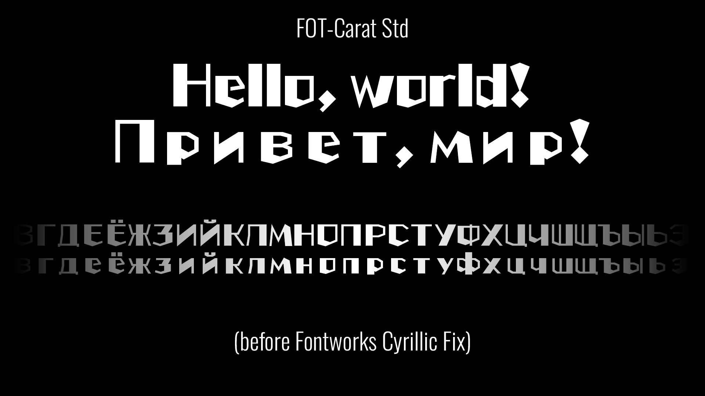
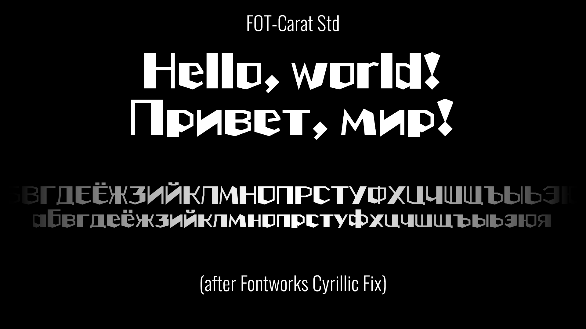

# Fontworks Cyrillic Fix

**Fontworks Cyrillic Fix** is a Python utility that adjusts the side bearings of Cyrillic glyphs in CFF-based OpenType fonts (`.otf`) so that Cyrillic text sits more naturally alongside Latin text.

It is especially useful for fonts in which Cyrillic glyphs are placed in full-width cells (often with an advance width of `1000` units) and centered inside those cells. In such fonts, Cyrillic letters can look unusually spaced compared with their Latin counterparts.

Fontworks Cyrillic Fix does not edit the glyphs. It repositions each supported glyph horizontally and updates its advance width to match the selected side bearings.

## Before and after

The images below show a font preview before and after applying Fontworks Cyrillic Fix. The Cyrillic letters retain their original shapes, while their horizontal spacing is adjusted to better match the Latin alphabet.

| Before | After |
| :--- | :--- |
|  |  |

## Features

-   Processes CFF-based OpenType fonts (`.otf`).
-   Adjusts the left and right side bearings of Russian Cyrillic letters:
    -   uppercase `А–Я`;
    -   lowercase `а–я`;
    -   `Ё` and `ё`.
-   Uses selected Latin glyphs as spacing references for visually similar Cyrillic glyphs.
-   Estimates italic slant automatically, or accepts a manually specified angle.
-   Rebuilds the affected CFF charstrings and updates horizontal metrics.
-   Supports processing multiple font files in one run.
-   Offers a dry-run mode to inspect the proposed changes without saving a font.
-   Can add a suffix to the output filename and update the font's internal naming records.

## Requirements

-   Python 3.8 or newer
-   [`fontTools`](https://fonttools.readthedocs.io/)

Install the dependency:

``` bash
python -m pip install fonttools
```

## Usage

Run the script from a terminal:

``` bash
python fontworks-cyrillic-fix.py font.otf
```

By default, the corrected font is saved next to the source file with `-Cyr` appended to its filename. For example:

``` text
FOT-CaratStd-UB.otf
FOT-CaratStd-UB-Cyr.otf
```

The source file is not overwritten.

### Process multiple fonts

Pass multiple paths or use a shell wildcard:

``` bash
python fontworks-cyrillic-fix.py *.otf
```

### Choose an output directory

``` bash
python fontworks-cyrillic-fix.py *.otf --outdir out/
```

The output directory is created if it does not exist.

### Specify the italic slant manually

Fontworks Cyrillic Fix estimates the slant by comparing the side bearings of the Latin glyphs `H`, `O`, `n`, `o`, and `u`. If automatic detection is unsuitable for a particular font, specify the angle in degrees:

``` bash
python fontworks-cyrillic-fix.py font.otf --slant 10
```

Use `--slant 0` to force upright-font handling.

### Preview changes without writing files

``` bash
python fontworks-cyrillic-fix.py font.otf --dry-run
```

Dry-run mode prints the original and proposed advance widths and the selected left and right side bearings. It does not save a corrected font or change the font's internal names.

### Customize the output suffix

``` bash
python fontworks-cyrillic-fix.py font.otf --suffix Fixed
```

This produces `font-Fixed.otf` and, unless `--no-rename` is specified, adds the suffix to the relevant internal font naming records.

### Keep the original internal font names

``` bash
python fontworks-cyrillic-fix.py font.otf --no-rename
```

The output filename still receives the selected suffix; only the internal name updates are skipped.

### Set a minimum side bearing

``` bash
python fontworks-cyrillic-fix.py font.otf --min-sb 15
```

By default, upright fonts use a minimum side bearing of `10` font units. This helps prevent glyphs with zero side bearings from colliding with adjacent letters. For slanted fonts, no minimum is applied by default because negative side bearings can be normal. Passing `--min-sb` explicitly overrides that default.

## How it works

For each supported Cyrillic character, Fontworks Cyrillic Fix:

1.  Finds the corresponding glyph in the font's character map.
2.  Chooses target left and right side bearings using the `MAP` table in `fontworks-cyrillic-fix.py`. Most values are taken from the corresponding side of a visually similar Latin glyph; special cases use calculated values or fallback rules.
3.  Estimates or uses the specified italic slant and measures glyph bounds in a horizontally deskewed coordinate space, so italic overhangs do not distort the spacing comparison.
4.  Calculates a horizontal offset for the glyph and a new advance width from the selected side bearings and the measured glyph width.
5.  Rebuilds the glyph's CFF charstring with the horizontal offset and updates its horizontal metrics (`hmtx`).

The mapping is intentionally rule-based. It is a practical starting point for fonts whose Cyrillic glyphs have been centered in full-width cells, not a universal substitute for manual font spacing or professional font hinting.

### Special cases

-   `Ё`/`ё` and many Cyrillic letters use the side bearings of Lating glyphs with similar shapes.
-   `З`/`з` use a fallback rule that avoids an unusually small left bearing from `S`/`s` when it is too small relative to `C`/`c`.
-   Letters with tails or feet, such as `Ц`/`ц`, `Щ`/`щ`, `Д`/`д`, use calculated bearing values based on the width of the Latin `H` glyph.
-   Glyphs absent from the font's character map are reported and skipped.

The mapping can be customized by editing `MAP` in `fontworks-cyrillic-fix.py`.

## Command-line options

| Option | Description |
| :--- | :--- |
| `fonts` | One or more input font paths. Required. |
| `-o`, `--outdir` | Output directory. Defaults to the directory containing each input font. |
| `--slant DEGREES` | Slant angle in degrees. Automatic detection is used when omitted. |
| `--min-sb VALUE` | Explicit minimum for both side bearings. By default, `10` for upright fonts and no minimum for slanted fonts. |
| `--suffix TEXT` | Output filename suffix and internal naming suffix. Defaults to `Cyr`. |
| `--no-rename` | Do not update internal font naming records. |
| `--dry-run` | Print proposed metrics without saving a font. |

## Limitations

-   **CFF-based OpenType only.** The script checks for the `CFF` table and skips fonts without it. It is not intended for TrueType-outline `.ttf` fonts.
-   **Spacing, not glyph design.** It changes horizontal placement and metrics; it does not redraw or stylistically harmonize Cyrillic glyphs.
-   **Limited character set.** The mapping covers `А–Я`, `а–я`, `Ё`, and `ё`. It does not attempt to process every Cyrillic character or every language-specific extension.
-   **Font-specific results.** The mapping and slant estimate are heuristic. Inspect the result in your target applications and adjust the mapping or options when necessary.
-   **Back up important fonts.** Fontworks Cyrillic Fix writes a new file, but you should still test the output before using it in production.

## Troubleshooting

-   **The font is skipped:** confirm that it is a CFF-based `.otf` font rather than a TrueType-outline font.
-   **Italic spacing looks wrong:** try `--slant` with a manually chosen angle.
-   **Letters still collide or have too much space:** inspect the dry-run output, adjust `--min-sb`, or customize `MAP`.
-   **Some letters are missing:** Fontworks Cyrillic Fix reports mapped characters that are absent from the font's character map.
